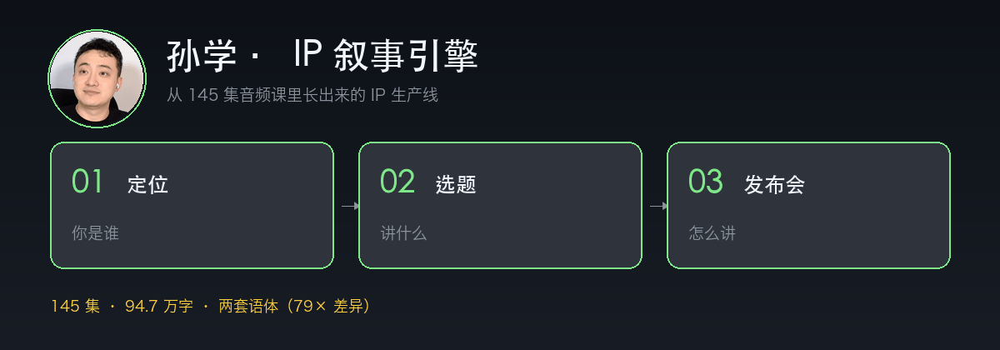
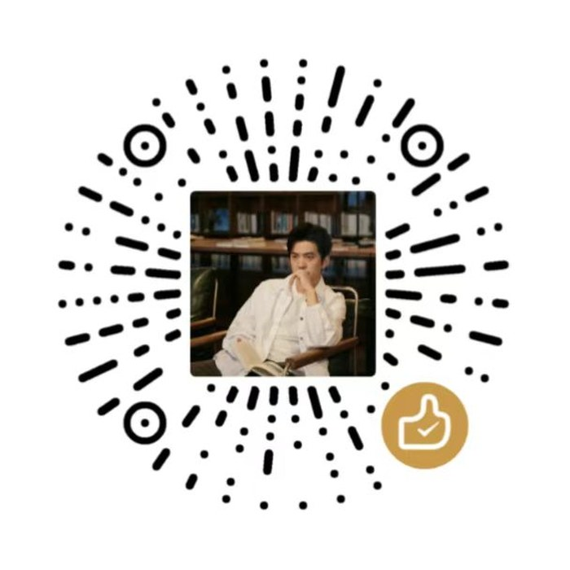
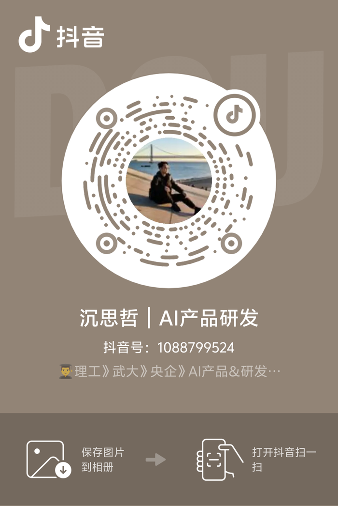
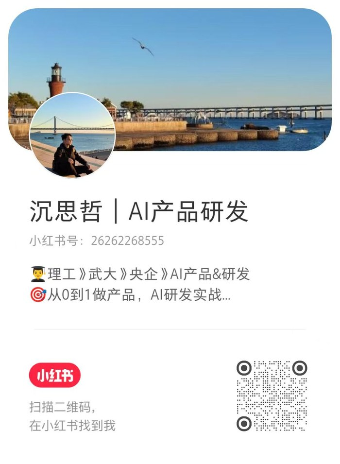

<div align="center">

# 孙学 · IP 叙事引擎

<p align="center">
  
</p>

> *「一代版本一代神。」*

[](LICENSE) [](#安装) [](#语料与方法)

<br>

**它不回答「孙宇晨会怎么看」，它回答「你这件事该怎么讲出去」。**

<sub>定位 → 选题 → 发布会，一条流水线 · 基于 145 集音频课 94.7 万字与 2026 年 4 小时访谈</sub>

<br>

[看效果](#效果示例) · [安装](#安装) · [它会什么](#它有三个动作) · [凭什么是它](#与已有实现相比) · [语料与方法](#语料与方法) · [边界](#它不做什么)

<br>

</div>

---

## 效果示例

### 一、定位

```text
用户 ❯ 我在教培行业做了八年，是个产品经理，最近用 AI 做了个人物研究工具，账号才 1300 粉。我该把自己定义成什么？

孙学 ❯ 先别定义。先回答一个问题：你手上有什么是别人不好有的？

        八年教培 + 会做产品 + 愿意公开过程，这三样同时具备的人不多。
        这就是你的位置。

        给你三个候选，按能撑多久排：

        1. 用 AI 做人物研究的产品经理 —— 能撑 2–3 年，窄，但精准
        2. 一个人干内容团队活的 AI 实践者 —— 1–2 年，容易和 AI 博主混在一起
        3. 教培行业里最懂 AI 的人 —— 撑多久取决于行业景气

        选第一个。因为「人物研究」这条路现在没人占，而教培在跌。

        一句话：教培八年，我用 AI 一个人做完了过去要团队做的人物研究。

        注意：这句故意省了「为谁」——你现在服务的是同行，不是付费客户，
        硬写一个「为内容创作者」反而空。等有第一个付费客户再补进去。

        注意：别写「AI 效率专家」。那是个标签，不是成果。没人能验证，也没人能记住。
```

### 二、选题

```text
用户 ❯ 给我几个选题，我做 AI 人物研究的。

孙学 ❯ 四组，每组两个。你挑，别全做。

        【版本切换】
        · 靠信息差赚钱的时代结束了，现在拼的是判断力
        · 会用 AI 写提示词不值钱了，值钱的是知道该问什么

        【熟悉对象 + 未知机制】
        · 那两个最常被引用的短语，他根本没说过
        · 这条 10 万赞的视频，其实是三个钩子叠起来的

        【低预期身份 + 高结果】
        · 不写代码的产品经理，用 AI 做出了 88 条证据的人物档案
        · 一条 2661 播放的内容，涨了 35 个粉

        【冲突对撞】
        · 巴菲特说比特币是老鼠药，他花 456 万美元请巴菲特吃饭

        评分最高的那两个是：「不写代码的产品经理」和「那两个短语他根本没说过」。
        前者有代入感，后者有增量。都过了 14 分线。
```

### 三、发布会文案

示例参数为虚构，只演示结构。真实使用时把每一句换成你的实测数据——skill 会再跑一遍事实清单。

```text
用户 ❯ 我做了个保温杯。帮我写成发布会。

孙学 ❯ 这不是一个保温杯。
        这是「个人饮水」的第一个操作系统。

        过去十年，这个品类没有进步。
        所有人都在做同一件事：把内胆做厚一点，把 logo 印大一点，
        然后在详情页写「24 小时长效保温」。

        没有人回答一个更基础的问题：
        你一天到底要喝多少度的水？它能撑多久？

        我拆了 37 个杯子，把每一条温度曲线画了出来。

        结果是：95℃ 的水倒进去，第 47 分钟掉到 55℃。
        而你一个会，要开 90 分钟。
        中间那 43 分钟，你喝的是凉水。

        所以我们做了三件事。

        第一，双层真空内胆。6 小时 68℃，12 小时 51℃。
        第二，杯口收到 42 毫米。刚好进车载杯架，刚好塞得进冰块。
        第三，整杯 218 克。比同容量轻 12 克——轻到你愿意带它出门。

        这不是参数堆叠。
        参数的意义是：你不需要再想它。

        这件事真正改变的，不是保温。
        是我们第一次给「喝水」这件事，装上了接口。

        人一天喝 8 次水，一辈子 20 万次。
        过去两百年，这个动作没有标准、没有反馈、没有数据。
        你喝的是几度，你不知道。身体需要几度，你也不知道。

        从现在起，它有了。

        为什么是现在？
        因为这是第一次，供应链愿意为一个人的想法开模。
        三年前，40 万的模具费把个人挡在门外。现在是 4 万。
        门槛没了。

        一个人，可以定义一个品类。
        这不是夸张。这是过去十二个月里，正在发生的事。

        想要完整参数表，评论区回「杯子」。
        下一集，我讲讲 42 毫米是怎么算出来的——为了这 4 毫米，我改了 11 版模具。
```

---

## 它有三个动作

| 动作 | 输入 | 输出 |
|---|---|---|
| **`/定位`** | 你的职业 + 一个可验证的成果 + 你独有的东西 | 一句话定位 + 三个候选标签 + 30 天验证动作 |
| **`/选题`** | 你的定位 + 可用素材 | 8 个候选（四公式各 2 个）+ 评分 + 需要的素材 |
| **`/发布会`** | 一件事 + 数字 + 读者 | 五段文案（定调/痛点/交付/升维/号召）+ 事实清单 |

三个动作可以单独用，也可以串起来：**定位决定选题，选题决定文案**。

---

## 一个统计发现

这个 skill 最硬的一块依据，是把 145 集音频课（94.7 万汉字）和 2026 年 4 小时访谈（3.5 万汉字）做了词频对比：

| 词 | 2016 课程（每万字） | 2026 访谈（每万字） | 倍数 |
|---|---|---|---|
| 认知 | 0.2 | **15.8** | 79× |
| 版本 | 0.4 | **9.6** | 24× |
| 机器 | 0.4 | **6.8** | 17× |
| 翻译 | 0.5 | **4.5** | 9× |
| 全球 | 1.0 | **3.9** | 4× |
| 革命 | **4.3** | 1.1 | 0.26× |

**他有两个人。**

- **2016 的他**：教学口吻，「其实」「大家」「就是」「举个例子」，讲财富、自由、革命
- **2026 的他**：断言口吻，「认知」「版本」「系统」「机器」「翻译」，讲窗口、底层、范式

所以这个 skill 内置了**两套语体开关**：讲道理时用 2016 的，写文案时用 2026 的。用错场合，会立刻显得假——用「版本答案」去讲一个 2016 年的道理，像在念稿；用「其实大家可能不知道」去写发布会，气势全无。

---

## 安装

```bash
# 方式一：clone 后复制到你的 skills 目录
git clone https://github.com/read2017/sunyuchen-ip-skill.git
cp -r sunyuchen-ip-skill ~/.claude/skills/     # Claude Code
# 或 ~/.codex/skills/ / ~/.hermes/skills/

# 方式二：支持 npx skills 的运行时
npx skills add read2017/sunyuchen-ip-skill
```

装好后直接说：

```
帮我把这个定位一下：我是做 XX 的，做成过 XX
给我 8 个选题，我做 XX 的
把这件事写成发布会：XX
```

---

## 与已有实现相比

孙宇晨相关的开源 skill 已经有好几个，先把它们列清楚，再说这个多什么。

| 项目 | 定位 | 语料 | 能力 |
|---|---|---|---|
| [0xquqi/sun-skill](https://github.com/0xquqi/sun-skill)（★351） | 孙宇晨认知操作系统 | 21,829 条推文 + 288 页自传 + 155 集音频课 + 269 来源 | 1 元模型 + 13 心智模型 + 19 启发式，**问答/角色扮演** |
| [alchaincyf/sun-yuchen-perspective](https://github.com/alchaincyf/sun-yuchen-perspective)（★252） | 注意力收割操作系统 | 6 维度调研 | 6 模型 + 8 启发式 + 5 种造句公式，**角色扮演** |
| [swaylq/sunge-skill](https://github.com/swaylq/sunge-skill)（★18） | 大脑 + 文风 + 决策三合一 | — | **综合型** |
| **本项目** | **IP 生产工具** | 145 集音频课 + 4 小时访谈 | **定位 / 选题 / 发布会，创作型，带模板与事实清单** |

**差异（可验证，不是形容词）：**

1. **能力方向不同**。上面三个都在回答「孙宇晨会怎么看」，输出是一段模仿他的回答；本项目回答「你这件事该怎么讲」，输出是**你能直接用的文案结构**。
2. **有模板**。三个动作各带一个可填写的模板文件，不是只给方法论。
3. **有语体数据**。两套语体的 79 倍词频差异是实测的，不是印象；语料规模不如 ★351 那个（它是我们的十倍），但**做了他没做的语体分层**。
4. **有事实清单**。每个文案输出后强制跑一遍数字/引语/承诺审计——这是「吹上天」和「造假」的分界线。

**诚实说**：如果你的需求是「让 AI 扮演孙宇晨跟我对话」，用 ★351 那个，它的语料比我们大得多。如果你的需求是「把我的东西讲出去」，用这个。

---

## 语料与方法

| 语料 | 规模 | 用途 |
|---|---|---|
| 孙宇晨 2016 年秋季音频课 | 145 集（公开版本为 155–156 集，本项目拿到的是 145 期转录，缺集未补齐） | 表达 DNA 统计、心智模型溯源 |
| 2026 年 4 小时 22 分访谈 | 3.5 万字（官方整理稿 + ASR 字幕） | 2026 语体、最新方法论 |
| 《这世界既残酷也温柔》（2017） | 公开章节与书评 | 定位框架、三不主义 |
| 公开报道与监管文件 | 参考了 88 条编号证据（**证据档案不在本仓库**） | 确保模型与示例不与公开事实冲突 |

**方法**：

1. 词频统计（n-gram + 关键词密度），得出两套语体
2. 三关筛选心智模型：跨域复现 / 生成力 / 排他性
3. 每个模型写**失效条件**——没有失效条件的模型是鸡汤
4. 保留矛盾：`references/tensions.md` 记了 5 对自相矛盾，防止把他说成一个统一的形象

**没有发布**：原始音频、逐字稿全文、书稿全文——版权在原权利人，仓库只放提炼结论与有限引用。

---

## 它不做什么

1. 不编造数据、资质、合作背书、引语
2. 不教人刷量、造假案例、规避平台监管
3. 不碰他人私生活与未审结案件
4. 不承诺「这样写一定爆」
5. 不给投资、法律、医疗建议

完整边界见 [`references/boundaries.md`](references/boundaries.md)。

---

## 目录结构

```
sunyuchen-ip-skill/
├── SKILL.md                      # 主文件：三个模式 + 工作流
├── references/
│   ├── models.md                 # 五个心智模型（含失效条件）
│   ├── heuristics.md             # 8 条决策启发式
│   ├── style-dna.md              # 两套语体 + 禁用词 + 数字规则
│   ├── tensions.md               # 5 对自相矛盾
│   ├── boundaries.md             # 诚实边界
│   ├── positioning.md            # 定位框架详解
│   ├── topics.md                 # 四个选题公式
│   └── launch-structure.md       # 发布会五段结构
├── templates/
│   ├── ip-positioning.md
│   ├── launch-narrative.md
│   └── topic-bank.md
└── assets/hero.gif
```

---

## 关于素材

头像是孙宇晨公开账号使用的形象，**仅用于标识本 skill 的研究对象**，不代表其本人观点、授权或合作；本 skill 也不代表孙宇晨本人。如本人或权利人提出，将立即移除。

原始音频、逐字稿全文、书稿全文不随仓库发布——版权在原权利人，仓库只放提炼结论与有限引用。

---

## 支持我

如果这个 skill 帮到了你：

- ⭐ **Star** —— 让更多人看到它
- **分享** —— 转给一个正在做账号、或者想研究某个人方法论的朋友

### 请我喝杯咖啡

<p align="center">
  
</p>

<p align="center"><sub>微信赞赏码 · 纯打赏，不用于购买服务（合作或咨询请发邮件 read2016@qq.com）</sub></p>

---

## 关于作者

<p align="center">
  我是 <b>沉思哲</b>，做 AI 产品与研发，平时折腾 AI 与内容创作。<br/>
  用法上有问题、想聊 IP、或者想看下一个被蒸馏的人，随时找我。
</p>

<table align="center">
<tr>
<td align="center" width="50%">
  
  <br/>
  <b>抖音</b>：沉思哲 ｜ AI产品研发<br/>
  <sub>抖音号：108799524</sub>
</td>
<td align="center" width="50%">
  
  <br/>
  <b>小红书</b>：沉思哲 ｜ AI产品研发<br/>
  <sub>小红书号：26262268555</sub>
</td>
</tr>
</table>

<p align="center">
  想做类似的人物 skill、想要全量语料、或者想聊聊 AI 产品：<br/>
  📮 <b>read2016@qq.com</b>
</p>

<p align="center">
  <sub>如果这个 skill 帮到你，给个 ⭐ 就行了。</sub>
</p>

<br>

<div align="center">
<sub>MIT License · 语料版权归原权利人 · 本项目为方法论提炼，不代表孙宇晨本人观点</sub>
</div>
